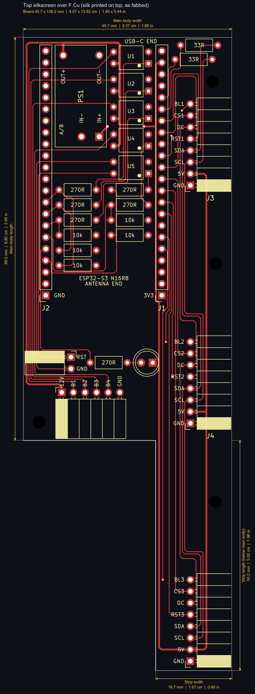
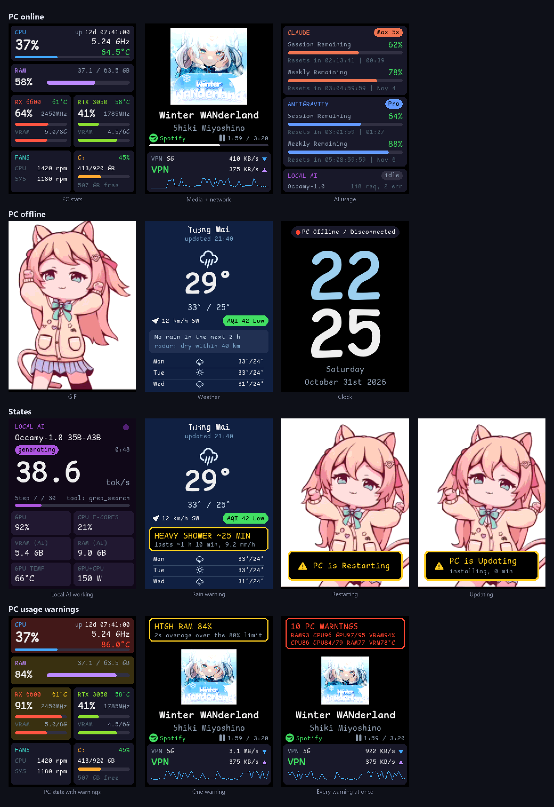

# ESP32 PC Control System

### Why would I put myself through the suffering

I needed my PC online at all time, because sometime at school or work I need to remote
control the PC back at home. And as I measured, the idle time alone costs me ~40KWh (~7usd) per month.
So, I built this for 30usd instead of buying a boring and expensive IP KVM, while adding a tons more
features to fit my over-engineering stuffs hobby.

<table><tr><td width="190" valign="top">

</td><td valign="top">

An ESP32-S3 carrier board that lives inside a PC case. It drives three 2.4"
displays, presses the motherboard's hardware-reset line, and works a 4-button
door remote, all from one ESP32-S3-N16R8 module plugged into a custom 2-layer
PCB.

### The board

- 45.7 x 138.2 mm, 2 layers, DRC 0/0 (rev 3.1, pictured: top silkscreen
  over the top copper)
- ESP32-S3-N16R8 module on sockets, three ST7789 panels on one SPI bus
- Optocouplers for the motherboard reset and the four keyfob buttons
- Native USB to a motherboard header: PC power state, stats link and USB
  power commands in one cable
- Wake-on-LAN, Discord bot and OTA over Wi-Fi

</td></tr></table>

## Screens



*Captured from the board itself with `shot` (see [Screenshots](#screenshots)).
The stats in this image are made up; the layout is real.*

Each panel shows a set of faces and picks one from the PC's state:

| Panel | PC on | PC off / asleep | Restarting / updating |
|---|---|---|---|
| 1 | PC stats: CPU, RAM, both GPUs, fans, C: | GIF, scaled to fill the screen height | GIF with a "PC is Restarting" / "PC is Updating" box on top |
| 2 | Media: cover art, title, artist, player, progress; uptime and network | Weather: now, AQI, 2-hour rain nowcast, 3-day forecast | Weather |
| 3 | AI usage: Claude and Antigravity quota left, local AI; full-screen local AI face while the model is working | Clock | Clock with the restart/update state |

Notes on what is shown:
- **Quota cards** show what is *left*, with a countdown and the reset time:
  `Resets in 02:13:41 | 14:09` for the 5-hour window,
  `Resets in 03:04:59:59 | Oct 28` (days:hours:minutes:seconds) for the
  weekly one. The board counts down on its own from the reset time the PC
  sends.
- **Non-Latin text** (Japanese song titles, artist names) is rendered on
  the PC with Windows' fonts and font fallback, then sent to the board as a
  4-bit alpha bitmap. The board caches the last 8 bitmaps.
- **Cover art** is 144x144, sent as RGB444 (31 KB per cover).
- **Weather warnings:** rain within 60 min puts a box on the media and weather
  faces (Light Rain / Heavy Shower / Storm, the ETA counting down each minute,
  how long it lasts); yellow until 20 min out, then red. Typhoons tracked from
  GDACS get a red box in their last 6 h and while they are here.
- **PC usage warnings** take that box's place on the media face while the PC
  is on: RAM above 80% (yellow) or 90% (red), CPU, GPU load or RX 6600 VRAM
  above 90% (yellow), and CPU, GPU, RAM or VRM temperature too high (red),
  each a 2 s average. The matching PC-face cards turn yellow or red too.
  Limits and the window are set with the `pcwarn` console command and kept in
  NVS.

## What it does

| Function | How |
|---|---|
| 3x status displays | GMT024-08-SPI8P 2.4" ST7789 panels (240x320) on one shared SPI bus, each with its own CS, RST and PWM backlight. They plug straight into the board's right-angle sockets. |
| Motherboard reset | Optocoupler (PC817) across the motherboard's RST pins, fully isolated from the rest of the board. |
| Door remote | Decased 4-button keyfob, powered from an onboard 5V->12V boost. Four optos press its buttons. |
| PC power state | Read from the module's native USB link to the motherboard header (USB active = PC on, suspend = asleep/off). See [docs/pc-power-detection.md](docs/pc-power-detection.md). |
| Status LED | 5 mm LED below the module, for a light pipe in the enclosure. |

## Power control

| Action | Path |
|---|---|
| Power on from shutdown | Wake-on-LAN magic packet on the home network (`wake`) |
| Shutdown / sleep / hibernate / restart | Over the module's USB-OTG link to the PC (`power <sleep\|hibernate\|restart\|shutdown>`), with a HID System Control fallback |
| Hard reset of a hung PC | RST opto (`reset` command) |
| Power cut | BIOS "Always Power On after AC loss" boots the PC when power returns |

What the PC needs for this:
- BIOS: Wake-on-LAN enabled, "Restore on AC power loss" = Power On. The
  ErP / deep-sleep option must be off, or the network card loses power at
  shutdown and WoL cannot work.
- Windows: Fast Startup off (it can stop WoL from working after a shutdown), and the network
  adapter's "Wake on Magic Packet" enabled. Updates sometimes reset these.
- Wired Ethernet: most WiFi adapters can't wake from shutdown.

If the ESP32 itself gets stuck, flipping the PSU switch power-cycles it, and
the AC-loss setting brings the PC back up. See
[docs/recovery-and-physical-access.md](docs/recovery-and-physical-access.md).

## Pin map (rev 3.1)

| Signal | GPIO |
|---|---|
| Display bus: MOSI / SCK / DC | 11 / 12 / 9 (MOSI and SCK through 33R) |
| Display 1: CS / RST / BL | 8 / 10 / 3 |
| Display 2: CS / RST / BL | 18 / 16 / 6 |
| Display 3: CS / RST / BL | 17 / 15 / 5 |
| Door buttons 1-4 (opto rows 1-4) | 39 / 40 / 41 / 42 |
| Motherboard reset (opto row 5) | 1 |
| Status LED | 2 |

Every opto GPIO has a 10k pull-down, so nothing gets pressed while the chip
boots. (That turned out not to hold in ROM download mode; see
[the eFuse note](#keyfob-presses-during-flashing-efuse-fix).) The netlist
([pcb/main.ato](pcb/main.ato)) is the source of truth;
`python scripts/check_pins.py` checks it against
[firmware/main/config.h](firmware/main/config.h).

## Assembly notes

- **Bridge the module's `IN-OUT` solder jumper.** On ESP32-S3-N16R8 boards
  of this type, the `5VIN` pin is input-only by default: a diode stops USB
  5V from reaching it. The carrier takes all of its 5V (all three displays
  and the boost) from that pin, so with the jumper open the displays stay
  dark. Once it is bridged, never feed `5VIN` from another supply while USB
  is plugged in.
- Display panels hang **down** below the board, screen facing out, header
  edge up. That is the only way round that puts panel pin 1 (GND) on socket
  pad 1. Match the GND silk label: plugged in the wrong way, every pin is
  reversed and 5V lands on CS.
- The module rides on its sockets ~11 mm above the board. The boost, the
  five optos and most resistors sit underneath it.
- Set the boost's A+B bridges for 12V and measure the output before
  connecting the keyfob.
- Unplug the motherboard RST cable before flashing any other test firmware
  that toggles GPIOs.
- On a new module, burn the `DIS_USB_OTG_DOWNLOAD_MODE` eFuse before the
  keyfob is connected (below).

### Keyfob presses during flashing (eFuse fix)

With the keyfob connected, its LED lit every time the board was flashed:
door buttons B1/B2 were being pressed.

Cause: in ROM download mode the ESP32-S3 ROM sets up USB-OTG download and
drives GPIO38/39/40 as outputs for an external USB PHY (VMO / VPO / OEN).
GPIO39 and GPIO40 are door rows 1 and 2, and a driven output beats the 10k
pull-downs. The application firmware never runs in download mode, so it
cannot stop this.

Fix: burn the one-time eFuse `DIS_USB_OTG_DOWNLOAD_MODE`:

```bash
espefuse.py -p <ROM port> burn_efuse DIS_USB_OTG_DOWNLOAD_MODE 1
```

After this, download mode leaves GPIO32 and up as inputs and the door rows
stay low. eFuses can only be written once, so this cannot be undone. What
still works afterwards:
- flashing over the USB-Serial-JTAG port (a 1200-baud touch on the app's COM
  port reboots into the ROM, which shows up as a new COM port;
  `scripts/idf_flash.py` does this);
- the application's own USB-OTG device (CDC console, a WinUSB bulk stats
  link, and vendor HID as the stats link's fallback and for the power button).

Only USB-OTG *download* is gone, which this board never used. A later PCB
revision could move the door rows off GPIO38-42 instead.

## Repository layout

| Path | Contents |
|---|---|
| [`firmware/`](firmware/) | The board's firmware, ESP-IDF 5.5 (below) |
| [`host/pc_stats/`](host/pc_stats/) | Windows service and per-user helper that feed the board: PC stats, media, local-AI status, Claude and Antigravity usage ([host/pc_stats/README.md](host/pc_stats/README.md)) |
| [`pcb/`](pcb/) | atopile netlist ([`main.ato`](pcb/main.ato)), KiCad board, custom footprints, design notes ([pcb/README.md](pcb/README.md)) |
| [`scripts/`](scripts/) | PCB build chain (netlist -> placement -> routes -> checks -> renders -> Gerbers), flashing, GIF/layout/OTA upload, screenshots ([scripts/README.md](scripts/README.md)) |
| [`docs/`](docs/) | Bench findings and design notes, [weather](docs/weather.md), [dashboard layouts](docs/layouts.md) |

## Firmware

`firmware/` is plain ESP-IDF 5.5 with LovyanGFX (a git submodule
behind a wrapper component) for drawing. Each panel draws into a PSRAM
sprite; the transport underneath is esp_lcd with RGB444 on the wire.

| Module | Does |
|---|---|
| `config.h`, `display_config.h` | Pins, timings, panel table |
| `display` | Panel init, flush task on core 0, dirty-rectangle engine, RGB444 push over SPI + DMA, backlights, SPI budget |
| `views` | What each panel shows (`pc`, `media`, `ai`, `gif`, `dash`, test views), saved in NVS |
| `screens` | The faces in the image above and which one each view picks |
| `layout` | JSON dashboard pages from `/ffat/layout.json` ([docs/layouts.md](docs/layouts.md)) |
| `pcstats`, `textimg`, `art` | Stats the PC sends; PC-rendered text bitmaps; cover art |
| `pcwarn` | PC usage warnings: 2 s averages against limits saved in NVS |
| `pc_state`, `pc_going` | PC power state from USB events; restart/update detection; status LED |
| `optos`, `power` | Door presses and the reset pulse; Wake-on-LAN and USB power commands |
| `weather`, `nowcast`, `owm`, `cyclone`, `owntracks`, `pushover` | Open-Meteo forecast and AQI, rain nowcast and warnings, OpenWeather One Call 4.0 minute-by-minute rain and alerts, GDACS typhoon tracking, phone location over MQTT, Pushover copies of the PC and weather announcements ([docs/weather.md](docs/weather.md)) |
| `board_time` | Wall clock: SNTP over Wi-Fi, else the time the PC sends |
| `net`, `discord` | Wi-Fi, mDNS, HTTP OTA and layout upload; Discord bot with an `/actions` panel |
| `gif_store` | GIF frames pre-packed as RGB444 with per-frame dirty rects, saved to FAT |
| `commands`, `console` | The text command set; USB CDC, UART, WinUSB bulk and vendor-HID transports |

How the display pipeline works:
- **Dirty rectangles:** the flush task compares each canvas with what is
  already on the glass in 8-row bands and sends only the changed
  rectangles, so a changed number costs about 1 KB and a static face costs
  nothing.
- **Event-driven redraw with an SPI budget:** faces redraw when their data
  changes or their own timer is due (the marquee at 25 fps, the clock once
  a second), and a token bucket keeps the shared bus under 85%. GIFs slow
  down instead of dropping frames when the bus is busy. `fps` shows and
  tunes it.
- **RGB444 on the wire** (12 bits per pixel, 25% less data than RGB565).
- **Two cores:** core 1 draws, core 0 diffs and sends. One GIF plays at its
  native 29.7 fps with the bus at 47%.

Other behaviour:
- **Door buttons B1-B4** (GPIO39-42): 500 ms presses, one at a time, with a
  500 ms gap enforced in firmware (the board has no hardware interlock).
- **Motherboard reset** (GPIO1): 200 ms pulse, only on the `reset` command,
  never at boot. All opto pins are driven LOW first thing at boot.
- **PC power state** from the module's own USB link, with a 30 s guard
  against the brief USB dropout at power-on. The backlights are meant to
  turn off when the PC sleeps or shuts down.
- **Status LED** (GPIO2, PWM). `led <0-100>` is perceptual brightness,
  capped at 35% duty.

  | LED | Means |
  |---|---|
  | Quick pulses, 100 ms | Loading: the board is booting, or the PC is on but its stats have not arrived yet |
  | Solid | Board and PC online |
  | Quick pulses, 200 ms | PC restarting or updating |
  | Slow breathing (3 s fade in and out) | PC asleep or off |

### Commands

One per line on the USB CDC console or the CH343 UART:

| Command | Does |
|---|---|
| `status`, `perf`, `pcstats [text]` | Board state; per-core CPU and bus load (run twice); stats received from the PC |
| `wifi scan` | The networks the board hears (channel, signal, security) and its allowed channels, then rejoins. A failed join logs its reason |
| `view <1\|2\|3> <pc\|media\|ai\|gif\|dash\|status\|stats\|metrics>` | What a panel shows (saved) |
| `face <1\|2\|3> <auto\|pc\|gif\|restart\|update\|media\|weather\|ai\|localai\|clock>` | Force one face, for testing and screenshots (not saved) |
| `shot <1\|2\|3>` | Screenshot of a panel, streamed as base64 on the CDC port |
| `pcsim <on\|off\|auto>` | Pretend the PC is on or off (LED, faces, backlights), for testing |
| `door <1-4> [ms]`, `reset`, `reboot` | Press a door button; pulse the motherboard reset; restart the board itself |
| `screenshot` | Post the PC's desktop to #logging for 5 min, then auto-delete (needs the service + a #logging webhook) |
| `mon <bright <n\|all> <0-100> \| power all on\|off>` | The PC's monitors, numbered from the left: brightness over DDC/CI, power through each model's method plus Windows' display off for `all` (done by PcHwCtl, which the PC service forwards to) |
| `night [on\|off\|start\|end\|status]` | Night mode: on/off = the automatic engage (saved); start/end = now, until input on the PC |
| `wake [force \| mac <AA:BB:..>]`, `power <sleep\|hibernate\|restart\|shutdown\|lock>` | Wake-on-LAN; power commands over USB (`lock` locks the signed-in session) |
| `going <restart\|shutdown\|update_restart\|update_shutdown\|sleep\|clear>` | Tell the board what the PC is about to do |
| `bl <1\|2\|3\|all> <0-100\|on\|off>`, `display <on\|off>`, `led <auto\|on\|off\|sweep\|0-100>` | Backlights (saved); all panels dark until `display on` (not saved); status LED |
| `fps [budget <20-95> \| cap <1\|2\|3> <1-60\|off>]` | SPI budget and per-panel frame caps |
| `layout <show\|reload\|default\|...>`, `weather <show\|refresh\|demo [rain\|typhoon]\|clear\|storms\|home <lat>,<lon>>` | Dashboard layouts; weather |

### Build and flash

```bash
firmware/idf.cmd build
python scripts/idf_flash.py --no-build
```

`idf_flash.py` stops the PC stats service, reboots the board into the ROM
with a 1200-baud touch, flashes over the ROM's USB-Serial-JTAG port and
starts the service again. `--idf coredump-info` runs any other `idf.py`
action on that port instead.

### Settings

Everything that describes this setup lives in one file,
`firmware/main/settings.h` (gitignored; copy `settings_example.h` to start).
The secrets come first (Wi-Fi, Discord, OTA, MQTT, Pushover, Wake-on-LAN,
OpenWeather), then about 140 settings grouped by topic: board pins and
panels, night mode hours and levels, PC warning thresholds, GPU and drive
labels, PcHwCtl fan and RGB names, weather and rain thresholds, poll periods,
and the PC helper's `HOST_*` keys (Process Lasso path and night E-cores,
named pipes, adapters to skip, fonts). Every key has a default equal to the
old hardcoded value in `settings_or_example.h`, so a key missing from
`settings.h` behaves as before. Without a `settings.h` (CI) the build uses
`settings_example.h`: placeholders, nothing joins a network.

- After editing `settings.h`, touch `firmware/main/settings_or_example.h`
  before building (ccache's direct mode once handed back a stale image; a
  real image is ~1.6 MB, a placeholder one ~1.1 MB). CMake re-runs on its
  own when `settings.h` appears or goes away.
- `host/pc_stats/build.cmd` reads only the `HOST_*` keys
  (`gen_settings.ps1` -> `Settings.g.cs`), so no secret ends up in the exe.
  Changing one means rebuilding and reinstalling the helper.
- Which board key takes which PcHwCtl feed key (`cpu_temp`, `gpu1_*`, the
  fans, ...) stays in `host/pc_stats/stats.ini`, read at run time next to the
  exe; which LibreHardwareMonitor sensor feeds each key is PcHwCtl's config.
- `scripts/check_pins.py` checks the `PIN_*` settings against `pcb/main.ato`.

The build compiles only the ESP-IDF components `main` needs (`MINIMAL_BUILD`).
`idf.cmd` caches what ESP-IDF's `export.bat` sets in
`%LOCALAPPDATA%\esp-idf-env\` (it saves about 3.5 s per call); delete that folder
after reinstalling or moving ESP-IDF.

The Discord bot uses up to four channels, each set by its channel id in
`settings.h` and off when empty:

| Key | Channel | Posts |
|---|---|---|
| `DISCORD_CH_PC` | #pc-announcement | Board online, PC on/off, restart and update, power keys, door, reset |
| `DISCORD_CH_WEATHER` | #weather-announcement | Rain and typhoon warnings, "cleared" posts, phone rain alerts, a weather update every 2 h from 06:00 to 20:00 |
| `DISCORD_CH_LOG` | #logging | The board's log, timestamped, in batches every 10 s |
| `DISCORD_CH_CONTROL` | #control | One control panel message with the `/actions` buttons, kept up to date |
| `DISCORD_SHOT_WEBHOOK` | webhook URL | Where the Screenshot button posts (auto-deleted after 5 min); empty disables it |

PC and weather posts fall back to `DISCORD_CHANNEL_ID` when their own key is
empty. Only `DISCORD_OWNER_ID` can use the buttons.

The panel (#control, or `/actions` for one that only you see) opens with a
category dropdown; picking one swaps the controls below it:

| Tab | Shows | Controls |
|---|---|---|
| Door | Door remote state | Door 1-4 |
| PC Control | PC state, board Wi-Fi, night mode | Wake PC, Lock, Sleep, Hibernate; Restart, Shut down, PC reset (these ask first); Screenshot; Night auto on/off; Start / End night now; Low power on/off |
| PC Case RGB LEDs | PcHwCtl's RGB rules and brightness | Mode, color and brightness dropdowns; target group (All, Motherboard, RAM) |
| PC Fan Control | Each fan's speed, rpm and temperature, the RX 6600 and RTX 3050 included (with Zero RPM) | Target (All fans, Case fans, one case fan, RX 6600, RTX 3050), speed (held 5/15/60 min) and curve dropdowns; a Zero RPM dropdown in place of the curve for a GPU; Auto releases the override |
| PC Monitor Control | Each monitor's power and brightness, numbered from the left | Target (one monitor or all), brightness in 10 % steps (DDC/CI); All screens on / off (each monitor's power method in PcHwCtl, plus Windows' display off) |
| Local Agent Control | Local model, phase, context, auto-unload | Load, unload, reload, context size, auto-unload, keep awake; restart the stack's services |
| ESP32 Board Control | Uptime, Wi-Fi, internal RAM, PSRAM, last restart reason, status LED | Status LED max brightness (10 % steps) and on/off (both saved); Restart board (asks first), Refresh weather, Reconnect Discord |
| ESP32 Display Control | Each panel's screen and backlight | A screen dropdown per panel (each with an Auto option; not saved, like `face`); a brightness dropdown for all panels (5 % steps + Off, saved) |

Every tab has a Refresh and, on an `/actions` panel, a Close. The Display tab
fills all five of Discord's action rows with dropdowns, so Refresh there is an
entry inside the category dropdown instead of a button.

**Night mode** (PC Control, console `night`) engages between 22:00 and 06:00
once the PC has had no keyboard or mouse input for 15 minutes (the service's
user-session half reads Windows' idle counter, stat `pc.idle_s`). It sets the
PC's RGB LEDs to 10 %, the board's panels to 10 % on their PC-off screens, and
caps the status LED at 20 %. It also turns the PC's displays off. Input on the
PC puts everything back, and 15 more idle minutes engage it again. At 06:00 the
board side goes back at once, and the LEDs go back as soon as the PC and
PcHwCtl answer. Each change is posted to #pc-announcement. "Night auto" is the
automatic engage; "Start night now" engages it at once, at any hour, until
input on the PC or "End night now".

**Low power mode** (PC Control button "Low power", console `night low on|off`)
is the night's power side by hand, at any hour, until turned off: Process
Lasso's night config (E-cores in efficiency mode, heavy exes left alone, the
same `!night 1` night mode sends), PC LEDs 10 %, board panels 10 % with their
normal faces, status LED capped at 20 %. Displays stay on, the PC never sleeps,
and input does not end it. It survives a board restart. On and off are posted
to #pc-announcement and Pushover; a night that ends while it is on leaves it on.

Guards against false triggers:

- **Wake check.** Input during the night only ends it if the next 10 s show a
  real return: more than 50 px of mouse travel, or 3 key / mouse button
  presses (`pc.in_px`, `pc.in_press` from the user-session half; gamepad
  buttons and sticks count too). A bumped mouse turns the displays off again
  and the night carries on.
- **Video.** No automatic start while a process keeps the display on (a video
  playing, a presentation): PcHwCtl reads `powercfg /requests` every 10 s and
  the PC service passes it on (`pc.disp_req`, `pc.disp_req_by`). The PC
  Control tab shows who holds it.

While engaged, the PC service has PcHwCtl move every non-critical
background process to four E-cores (14-17 on the Core Ultra 7 265K) in Process
Lasso's config (`C:\ProgramData\ProcessLasso\config\prolasso.ini`), pin the
running ones at once and put them in Windows' efficiency mode (`lasso save
day`, then `aff set` and `eco on` per exe; PcHwCtl puts new instances in
efficiency mode too). The kernel and session processes, the desktop shell,
audio, this stack, Process Lasso and its ProBalance exclusions are left alone.
So is a heavy exe: one averaging 0.8 cores or more (1.0 = one core busy,
summed over its instances) for 2 minutes, such as a render or a long
calculation, and the foreground full-screen app (a game can be light on CPU).
The check runs all night: a pinned exe that turns heavy gets its day rule back
and leaves efficiency mode, and an exe left alone is pinned once it stays
under 0.3 cores for 5 minutes. When the night ends, `lasso load day` puts the
normal config back and `eco off all` lifts efficiency mode. If the board stops
confirming the night for 5 minutes, the service does that by itself.

Sleep and hibernate (Windows' own timers off; the board keeps them, in the
night window only): 1 hour after the last real input on the PC (false wakes
don't count) the board sleeps the PC, after 2 hours it hibernates it. Both
wait, with the displays off, while an exe is heavy (`pc.heavy`, kept ones such
as Defender scans included), a power request keeps the PC up (`pc.disp_req`,
`pc.sys_req`, `pc.exec_req`, minus `NIGHT_REQ_IGNORE`: `claude.exe` always
holds one) or the network averages more than 1 MB/s either way. A PC that
night mode put to sleep is woken and hibernated an hour later, after 06:00
too, unless someone powers it on first; a hibernated one stays so until it is
powered on. When the PC comes back the board sends its night state at once,
so the day config is back right after power-on.

Lock needs the PC stats service: the board has no keyboard to send Win+L, so
the service starts `LockWorkStation` in the signed-in session.

**Screenshot** (PC Control) captures the whole desktop (every monitor in one
image) and posts it to a Discord webhook for 5 minutes, then deletes the post;
the local file in `%temp%` is removed as soon as it is uploaded. The board only
asks (`!shot` over HID, with the webhook from settings.h); the capture, overlay
and upload run in the signed-in session, because the SYSTEM service cannot see
the desktop. Right after the capture, a red border and "Screenshot Captured" in
red show on every monitor for 5 s - these are drawn *after* the capture, so they
are never in the image. If nobody is logged in (locked / login screen) it just
logs and does nothing; two presses close together are coalesced (the second is
dropped while the first is in flight).

Set it up with one line in settings.h (keeps the config in one place):

1. In Discord: #logging -> Edit Channel -> Integrations -> Webhooks -> New
   Webhook -> Copy Webhook URL.
2. `#define DISCORD_SHOT_WEBHOOK "https://discord.com/api/webhooks/..."` in settings.h.

Empty (the default) disables the button: it answers "no screenshot webhook in
settings.h".

Some motherboards drag the USB 5 V rail down while the PC powers on from
shutdown: the board browns out and restarts (`boot: last reset: brownout` in
the log). Every wake therefore turns the backlights off while the WoL / USB
wake goes out and for 200 ms after it (`POWER_WAKE_DIM_MS` in settings.h). It
used to be a switch; it is always on since the brownout came back on
2026-10-27 (the author suspects capacitance on the motherboard bleeding off).
Seen on the author's board, both with Wake PC and with the PC's own power
button; waking from sleep is not affected.

It does not cover a power-on from the PC's own power button, which never goes
through the board. The real fix is a supply that the PC's power-on cannot pull
down. The ESP32 board's second USB port is not that supply: its 5 V in and out
are bridged, so feeding 5 V there while the PC's USB also powers the board would
damage it. What would work is an 18650 cell with a 5 V boost converter feeding
the board, plus some way to charge the cell; not worth it on the author's setup,
but an option if your board browns out on every power-on.
Once Wi-Fi is up, `python scripts/ota_upload.py` flashes over the network.

### Screenshots

```bash
python scripts/panel_shot.py 2 media.png --scale 2
python scripts/readme_shots.py docs/images/screens.png
```

`panel_shot.py` saves one panel. `readme_shots.py` builds the image at the
top: it stops the stats service, feeds the board a made-up stats frame,
forces every face in turn, captures it and tiles the results (run it from an
elevated shell).

## PC side

`host/pc_stats` builds one program, `ESP32-Helper.exe`, a self-contained
single-file .NET 10 exe (needs the .NET 10 SDK to build, nothing to run;
hardware sensors come from PcHwCtl's sensor feed, `E:\PC Hardware
Controller`, the only LibreHardwareMonitor reader on the PC). It runs as two
processes:

- **The Windows service** (SYSTEM, session 0): reads PcHwCtl's sensor feed
  and Windows performance counters, forwards the board's monitor and night
  mode commands to PcHwCtl, polls the local AI
  status hub and Claude's usage, and streams everything to the board over a
  WinUSB bulk pipe (no driver install; vendor HID as the fallback; the COM
  port stays free either way). It also renders
  non-Latin text for the board and sends cover art.
- **The user-session half** (`--user`, started and restarted by the service
  in the signed-in user's session, as that user): media info from Windows'
  media session (Spotify, browsers), Antigravity quota, the Claude Code login
  refresh, and board-requested screenshots. Session 0 can't see the desktop
  or media sessions, hence the second process. The two talk over anonymous
  pipes.

Details worth knowing:
- **CPU load** uses `% Processor Time`. `% Processor Utility` (what Task
  Manager shows) is scaled by clock speed and goes past 100% when the CPU
  boosts.
- **GPU load** is averaged over ~2 s on the board. At idle clocks the
  RTX 3050 reports bursty utilisation: it renders the desktop and wallpaper
  at 210-315 MHz, so the raw value jumps between 0 and 50%.
- **Claude usage** comes from the same endpoint Claude Code uses. The
  helper refreshes the Claude Code login shortly before it expires and
  writes the new token back to `~/.claude/.credentials.json`, so the card
  keeps working when Claude Code is not running.
- **Antigravity quota:** the 5-hour Flash window comes from Google's API
  with agy's stored login. The weekly Gemini window is only shown in agy's
  own `/usage` panel, so every 10 minutes the helper runs `agy` in a pseudo
  console, types `/usage` and reads the result. It then removes the lines
  this adds to agy's prompt history.
- **Windows updates:** the service sends `pc.update=1` while Windows is
  installing updates with nobody signed in (a servicing worker such as
  `TiWorker` running and no `explorer`): the "Working on updates" screen
  before the restart and "Updates are underway" after it. The board keeps
  its Updating faces until that goes back to 0 and the PC is back.
- Tokens are never logged.

See [host/pc_stats/README.md](host/pc_stats/README.md) for `stats.ini`,
install and command-line options.

## Bring-up findings (2026-10, assembled rev 3.1 board)

- **SPI runs at 40 MHz.** 80 MHz gives blank panels on the carrier's long
  shared bus, even with full drive strength on SCK/MOSI/DC. The S3's SPI
  clock is 80 MHz divided by a whole number, so 60 MHz is not possible: the
  driver rounds it down to 40.
- **Bus budget:** a full 240x291 frame takes 29 ms as RGB565 at 40 MHz, or
  about 21 ms as RGB444. That is enough for one full-motion panel at about
  30 fps. More full-motion panels share the bus, which is why the faces
  rely on dirty rectangles.
- **Broadcast mode** (all CS lines held LOW, one frame sent to all three
  panels at once) plays the same GIF on all three at its native 29.7 fps.
  It is only useful when all three show identical content.
- **Panel init:** do not issue a software reset (`esp_lcd_panel_reset`
  without an RST pin). The ST7789 ignores the wake-up command for 120 ms
  after a reset, so the panel stays asleep: backlight on, no picture. The
  firmware uses the hardware RST lines instead.
- **Backlight:** the GMT024 panels are dim even at 100% PWM, because of the
  module's own backlight parts. Firmware can't change that.
- **Opto resistors:** the 270R opto resistors are required. Without them
  the LED still lights, but the GPIO runs at its current limit.
- **ROM download mode drives GPIO38-40**, which pressed the keyfob during
  flashing. Fixed with an eFuse, see
  [above](#keyfob-presses-during-flashing-efuse-fix).
- **Main task stack:** 16 KB. With 8 KB, drawing the 128 px clock digits
  overflowed the stack and rebooted the board.

## Building the PCB

Toolchain: [atopile](https://atopile.io) 0.2.x, KiCad 10 (its bundled
Python provides `pcbnew`), Freerouting, and Python with pymupdf + Pillow for
the renders. The full rebuild, from `ato build` to DRC, renders and Gerbers,
is listed step by step in [scripts/README.md](scripts/README.md). Renders
land in `pcb/build/renders/` (not tracked); the image above is a copy.

## Checks

CI ([.github/workflows/ci.yml](.github/workflows/ci.yml)) runs
`scripts/check_pins.py` and lints the scripts on every push. The ESP-IDF
firmware is not built in CI yet.

## Status

Rev 3.1 is fabricated and assembled, and the firmware runs on it:
- all three panels and every face shown above;
- PC power detection over the module's own USB link, the motherboard RST
  output (checked with an LED on J6) and the door/reset commands;
- the stats link, media with cover art, PC-rendered text, Claude and
  Antigravity quota;
- the eFuse fix: no more keyfob presses while flashing.

Still to do:
- fill `settings.h` (Wi-Fi, Discord, OTA), then test Wake-on-LAN, the
  Discord bot, OTA and live weather (`weather home <lat>,<lon>`);
- test the USB power commands and door buttons B1-B4 on the real PC and
  keyfob;
- build the ESP-IDF firmware in CI.
